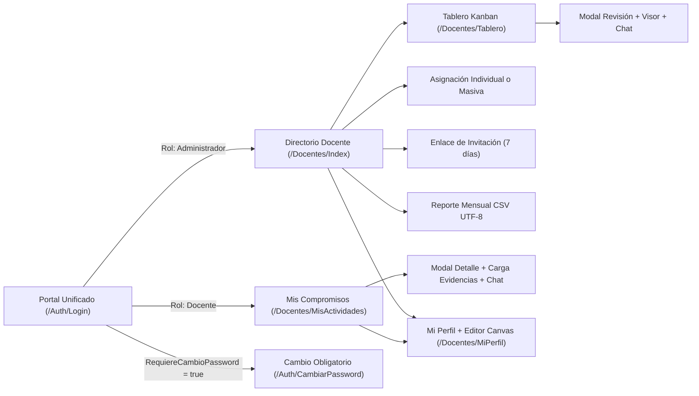
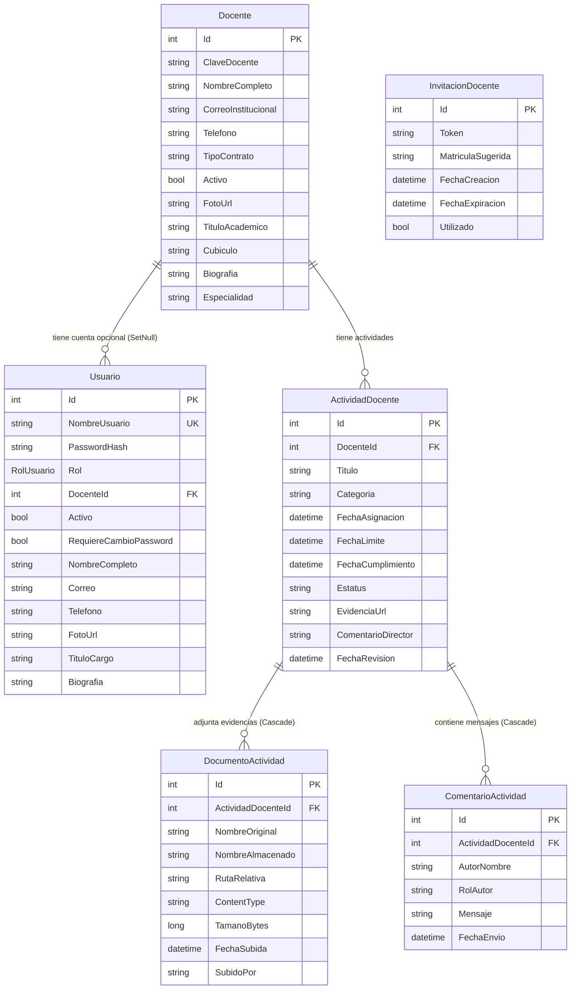

# SIGED · UPVM — Sistema Integral de Gestión Docente (`DirectorioDocente`)

Aplicación web **ASP.NET Core MVC (.NET 10)** diseñada para la **Universidad Politécnica del Valle de México (UPVM)** que centraliza el directorio académico, la asignación y seguimiento de compromisos docentes mediante tablero Kanban interactivo, la entrega y previsualización de evidencias documentales, la comunicación bidireccional Dirección–Docente, la exportación de reportes mensuales y la edición de perfiles institucionales con recorte fotográfico en navegador.

---

## Tabla de Contenidos

1. [Stack Tecnológico y Decisiones de Diseño](#stack-tecnológico-y-decisiones-de-diseño)
2. [Arquitectura y Estructura del Proyecto](#arquitectura-y-estructura-del-proyecto)
3. [Guía de Funcionalidades: Uso, Implementación y Justificación](#guía-de-funcionalidades-uso-implementación-y-justificación)
   - [3.1 Acceso Unificado, Sesión por Cookies y Fondo Animado](#31-acceso-unificado-sesión-por-cookies-y-fondo-animado)
   - [3.2 Cambio Obligatorio/Voluntario de Contraseña y Restablecimiento](#32-cambio-obligatoriovoluntario-de-contraseña-y-restablecimiento)
   - [3.3 Directorio Docente, KPIs, Buscador, Invitaciones y Asignación Masiva](#33-directorio-docente-kpis-buscador-invitaciones-y-asignación-masiva)
   - [3.4 Tablero Kanban (Desktop + Táctil con Pointer Events)](#34-tablero-kanban-desktop--táctil-con-pointer-events)
   - [3.5 Portal de Actividades del Docente, Filtros y GSAP easeReverse](#35-portal-de-actividades-del-docente-filtros-y-gsap-easereverse)
   - [3.6 Revisión de Evidencias, Visor Integrado, Chat y Reportes CSV](#36-revisión-de-evidencias-visor-integrado-chat-y-reportes-csv)
   - [3.7 Mi Perfil, Recortador HTML5 Canvas y Sincronización del Sidebar](#37-mi-perfil-recortador-html5-canvas-y-sincronización-del-sidebar)
   - [3.8 Sistema de Diseño, Diálogos Nativos y SvgIconTagHelper](#38-sistema-de-diseño-diálogos-nativos-y-svgicontaghelper)
4. [Modelo de Datos y Migraciones](#modelo-de-datos-y-migraciones)
5. [Referencia Rápida de Endpoints](#referencia-rápida-de-endpoints)
6. [Instalación y Ejecución Local](#instalación-y-ejecución-local)
7. [Consideraciones de Seguridad y Despliegue](#consideraciones-de-seguridad-y-despliegue)

---

## Stack Tecnológico y Decisiones de Diseño

| Tecnología / API | Versión / Config | Por qué se utilizó en el proyecto |
| :--- | :--- | :--- |
| **ASP.NET Core MVC** | `.NET 10.0` | Renderizado híbrido rápido desde servidor mediante vistas Razor con separación clara entre modelos, controladores y autorización declarativa por roles (`Administrador` / `Docente`). |
| **Entity Framework Core + SQLite** | `10.0.12` (`directorio.db`) | Persistencia relacional ligera en un único archivo sin depender de un motor SQL externo en desarrollo o despliegue local, manteniendo historial completo mediante migraciones Code-First. |
| **Cookie Authentication** | Esquema `SigedCookie` (`siged_session`) | Sesiones firmadas y cifradas por el servidor sin exponer tokens en `localStorage`, con bandera `HttpOnly`, `SameSite=Strict` y almacenamiento de *claims* visuales (`NombreCompleto`, `FotoUrl`) para renderizado inmediato del layout. |
| **Tailwind CSS** | `3.4.17` (`input.css` → `site.css`) | Estilizado utilitario compilado estáticamente (sin JIT en cliente) para mantener consistencia visual, bajo peso en producción y diseño adaptable móvil/escritorio. |
| **GSAP** | `3.15.0` (`wwwroot/lib/gsap/gsap.min.js`) | Coreografías de entrada, líneas de tiempo reversibles con `easeReverse` y presentación *Ken Burns* a 60 fps usando únicamente propiedades de compositor (`transform`, `opacity`), con respeto automático a `prefers-reduced-motion`. |
| **APIs Web Nativas** | `<dialog>`, `<canvas>`, `Pointer Events`, `Sanitizer API` | Menor acoplamiento a plugins externos: modales en *top layer* nativo con `closedby="any"`, recorte de avatar 100 % en cliente, arrastre unificado en pantallas táctiles/lápiz y sanitización defensiva con respaldo en **DOMPurify 3.2.4**. |
| **SvgIconTagHelper** | `<icon name="..." />` | Inyecta SVGs locales desde `wwwroot/assets/icons/` directamente en el HTML generado para eliminar peticiones HTTP extra y aplicar clases Tailwind y atributos de accesibilidad automáticamente. |

---

## Arquitectura y Estructura del Proyecto

### Flujo de Roles y Módulos



### Estructura de Archivos

```text
DirectorioDocente/
├── DirectorioDocente.slnx
├── package.json                                  # Scripts Tailwind CSS (v3.4.17) y dependencia GSAP (v3.15.0)
├── tailwind.config.js                            # Escaneo de vistas .cshtml y scripts .js
└── DirectorioDocente/
    ├── Program.cs                                # Configuración DI, Auth SigedCookie, migraciones y seed inicial
    ├── DirectorioDocente.csproj                  # Proyecto .NET 10 + paquetes EF Core Sqlite/Design/Tools
    ├── appsettings.json                          # Cadena SQLite (directorio.db) y límite Kestrel de 10 MB
    ├── Controllers/
    │   ├── AuthController.cs                     # Login, Logout, Acceso, CambiarPassword y RestablecerPassword
    │   ├── DocentesController.cs                 # CRUD docente, Kanban, evidencias, chat, CSV, registro y perfil
    │   └── HomeController.cs                     # Vistas base / manejo de errores
    ├── Helpers/
    │   └── PasswordHelper.cs                     # Hash SHA-256 con sal por usuario y verificación constante
    ├── TagHelpers/
    │   └── SvgIconTagHelper.cs                   # Etiqueta <icon name="..." class="..." />
    ├── Models/
    │   ├── ApplicationDbContext.cs               # DbSets, índices únicos, DeleteBehavior y HasData inicial
    │   ├── Usuario.cs                            # Cuenta de acceso, RolUsuario (Administrador/Docente) y perfil admin
    │   ├── Docente.cs                            # Ficha académica/administrativa y perfil docente
    │   ├── ActividadDocente.cs                   # Compromiso asignado, categoría, fechas, estatus y revisión
    │   ├── DocumentoActividad.cs                 # Metadatos y ruta relativa de evidencias subidas
    │   ├── ComentarioActividad.cs                # Mensajes bidireccionales del chat de actividad
    │   ├── InvitacionDocente.cs                  # Tokens temporales de auto-registro
    │   ├── LoginViewModel.cs
    │   ├── PasswordViewModels.cs
    │   ├── AsignarActividadViewModel.cs
    │   └── MiPerfilViewModel.cs
    ├── Migrations/                               # 7 migraciones Code-First de SQLite (Inicial → PerfilYComentarios)
    ├── Views/
    │   ├── Shared/_Layout.cshtml                 # Shell sidebar/header, tokens CSS, modales globales y utilidades JS
    │   ├── Auth/
    │   │   ├── Login.cshtml                      # Portal de acceso con fondo slideshow GSAP
    │   │   ├── CambiarPassword.cshtml            # Cambio obligatorio/voluntario con medidor en tiempo real
    │   │   └── Acceso.cshtml                     # Vista de acceso denegado
    │   └── Docentes/
    │       ├── Index.cshtml                      # KPIs, buscador pre-indexado, modales Asignar/Invitar/Reset
    │       ├── Create.cshtml / Edit.cshtml       # Alta y edición administrativa de docentes
    │       ├── Tablero.cshtml                    # Kanban 4 columnas con drag desktop + touch Pointer Events
    │       ├── _OdooCardPartial.cshtml           # Tarjeta de compromiso dentro del tablero Kanban
    │       ├── MisActividades.cshtml             # Vista docente con filtros por fecha y GSAP easeReverse
    │       ├── MiPerfil.cshtml                   # Ficha editable minimalista + estudio Canvas de fotografía
    │       └── Registro.cshtml / RegistroExitoso.cshtml
    └── wwwroot/
        ├── assets/icons/                         # 38 íconos SVG consumidos por <icon />
        ├── assets/img/                           # upvm.png e imgupvm.jpeg para el login
        ├── css/input.css & site.css              # Entrada y salida compilada de Tailwind CSS
        ├── js/home.js & site.js                  # Scripts estáticos del proyecto
        ├── lib/                                  # Bootstrap, jQuery, jQuery Validation y GSAP
        └── uploads/                              # Almacenamiento en tiempo de ejecución (docs/ y avatars/)
```

---

## Guía de Funcionalidades: Uso, Implementación y Justificación

### 3.1 Acceso Unificado, Sesión por Cookies y Fondo Animado

#### Instrucciones de uso
1. Al ingresar a la raíz del sitio (`/` o `/Auth/Login`), tanto **Dirección** como **Cuerpo Docente** utilizan el mismo formulario.
2. Ingresa tu matrícula (ejemplo `1845695412`) o usuario administrativo (`director`) y tu contraseña.
3. Marca **Mantener sesión iniciada** si deseas conservar la sesión persistente hasta por **30 días**; sin esta opción, la cookie caduca en **8 horas** con renovación deslizante (*Sliding Expiration*).
4. Si la cuenta tiene marcada la bandera de primer acceso o restablecimiento (`RequiereCambioPassword = true`), el sistema redirige automáticamente a `/Auth/CambiarPassword?obligatorio=True` antes de entrar al panel correspondiente a tu rol.

#### Cómo se hizo
- **Configuración de Cookie (`DirectorioDocente/Program.cs`)**: Se registró el esquema `"SigedCookie"` (`siged_session`) con `HttpOnly = true`, `SameSiteMode.Strict`, `ExpireTimeSpan = TimeSpan.FromHours(8)` y `SlidingExpiration = true`.
- **Autenticación y Claims (`DirectorioDocente/Controllers/AuthController.cs` → `Login`)**:
  - Normaliza `NombreUsuario` con `.Trim().ToLower()`.
  - Verifica el hash mediante `PasswordHelper.VerifyPassword(nombreNorm, model.Password, usuario.PasswordHash)` en `DirectorioDocente/Helpers/PasswordHelper.cs`, el cual calcula `SHA256` sobre `"{nombreUsuario.ToLower().Trim()}:{password}"`.
  - Emite el `ClaimsPrincipal` con `NameIdentifier`, `Name`, `Role`, `NombreCompleto`, `FotoUrl`, `DocenteId` y `RequiereCambioPassword`, y en `RedirectToUserHome` dirige a `/Docentes/Index` si es `Administrador` o a `/Docentes/MisActividades` si es `Docente`.
- **Fondo Ken Burns con Crossfade (`DirectorioDocente/Views/Auth/Login.cshtml`)**:
  - Dos capas `` (`#loginBgSlide1` con `~/assets/img/upvm.png` y `#loginBgSlide2` con `~/assets/img/imgupvm.jpeg`) usan `will-change-transform` bajo un degradado oscuro para garantizar contraste del formulario.
  - Una línea de tiempo infinita (`gsap.timeline({ repeat: -1 })`) anima cada imagen durante **`duracionImagen = 10` segundos** combinando `scale`, `xPercent` y `yPercent` con `ease: 'none'`, y realiza un **crossfade de `duracionCrossfade = 1.6` segundos** (`ease: 'power1.inOut'`) superponiendo el inicio del desplazamiento de la segunda imagen justo al comenzar la transición. Antes de regresar a la primera diapositiva, `tl.set(slide1, ...)` reinicia su encuadre mientras permanece en `opacity: 0` para evitar saltos visuales. Si el usuario tiene activado `(prefers-reduced-motion: reduce)`, se omite la animación y se deja fija la primera imagen.

#### Por qué se utilizó
- **Unificar el acceso bajo `SigedCookie`** evita duplicar portales de login por rol y protege la cookie frente a lectura desde JavaScript (`HttpOnly`) y ataques CSRF entre sitios (`SameSite=Strict`), mientras los *claims* permiten mostrar nombre y avatar en el menú lateral sin consultar la base de datos en cada vista (con consulta de respaldo en `_Layout.cshtml` si la cookie proviene de una sesión anterior sin el claim `FotoUrl`).
- **Animar solo `transform` (`scale`, `xPercent`, `yPercent`) y `opacity` con GSAP** mantiene todo el movimiento del slideshow dentro de la fase de composición del navegador (GPU), evitando repintados costosos del DOM o vibración subpíxel en pantallas de alta densidad.

---

### 3.2 Cambio Obligatorio/Voluntario de Contraseña y Restablecimiento

#### Instrucciones de uso
- **Usuario autenticado**: Desde el botón **Clave** en el pie del menú lateral (o de forma obligatoria al iniciar con clave temporal), accede a `/Auth/CambiarPassword`. Escribe tu nueva contraseña (mínimo 6 caracteres, al menos un número y distinta a tu matrícula) y confírmala; los 4 indicadores visuales de fortaleza se actualizan mientras escribes y el icono del ojo alterna visibilidad.
- **Dirección (Administrador)**: En `/Docentes/Index`, dentro del menú de opciones de cada docente con cuenta vinculada, selecciona restablecer contraseña. El sistema genera una clave temporal de 8 caracteres y abre el diálogo `#modalReset` con botones de copiado rápido al portapapeles. En su siguiente inicio de sesión, el docente será obligado a definir su contraseña personal.

#### Cómo se hizo
- **Evaluación en tiempo real (`DirectorioDocente/Views/Auth/CambiarPassword.cshtml`)**: `evaluarFuerza(val)` valida en cliente 4 criterios (`val.length >= 6`, `/\d/.test(val)`, comparación distinta a `@User.Identity?.Name`, y combinación de mayúsculas `/[A-Z]/` o caracteres especiales `/[^a-zA-Z0-9]/`) actualizando `#barra1..#barra4`, `#fuerzaTexto` y la coincidencia con `#inputConfirmar`.
- **Actualización y re-emisión de sesión (`DirectorioDocente/Controllers/AuthController.cs`)**:
  - `CambiarPassword` (POST) valida en servidor la contraseña actual cuando `EsObligatorio == false`, bloquea contraseñas iguales a la matrícula, actualiza `PasswordHash` y `RequiereCambioPassword = false`, y vuelve a firmar la cookie reemplazando el claim `"RequiereCambioPassword"` por `"False"`.
  - `RestablecerPassword` (POST, `[Authorize(Roles = "Administrador")]`) invoca `GenerarPasswordTemporal()`, generando 8 caracteres del alfabeto `"abcdefghjkmnpqrstuvwxyz23456789"`, marca `RequiereCambioPassword = true` y responde JSON consumido por `restablecerPassword()` en `Index.cshtml`.

#### Por qué se utilizó
- **Re-emitir los claims inmediatamente al cambiar contraseña** evita forzar un segundo inicio de sesión tras cumplir el cambio obligatorio y mantiene sincronizado el indicador visual del sidebar.
- **Excluir caracteres visualmente ambiguos (`i`, `l`, `o`, `0`, `1`)** en `GenerarPasswordTemporal()` reduce errores de transcripción cuando Dirección entrega credenciales temporales por teléfono o mensajería.

---

### 3.3 Directorio Docente, KPIs, Buscador, Invitaciones y Asignación Masiva

#### Instrucciones de uso
1. **Consultar KPIs y filtrar plantilla (`/Docentes/Index`)**: Revisa la banda superior con *Plantilla Registrada*, *Al Corriente*, *Con Rezago* e *Índice de Cumplimiento*. Escribe en `#buscadorDocente` (pulsa `ESC` para limpiar) o usa los botones de filtro (*Todos*, *Tiempo Completo*, *Asignatura*, *Al corriente*).
2. **Dar de alta docentes**:
   - *Alta directa*: Clic en **Nuevo Docente** (`/Docentes/Create`) para capturar matrícula, nombre, correo, teléfono y tipo de contrato; automáticamente se crea su `Usuario` con la matrícula como contraseña temporal.
   - *Enlace de invitación*: Clic en **Invitar Docente** (`abrirModalInvitar()`), opcionalmente sugiere una matrícula y genera un enlace `/Docentes/Registro?token=...` válido por **7 días** y un solo uso para que el profesor complete su propio registro.
3. **Asignar compromisos**: Abre el diálogo **Asignar Actividad** (`abrirModalAsignar()`), elige el título, categoría (*Académica*, *Evaluación*, *Tutoría*, *Administrativa*), fecha límite y el modo de asignación (*Docente individual*, *Todos los docentes*, *Tiempo Completo* o *Asignatura*).

#### Cómo se hizo
- **KPIs en servidor (`DirectorioDocente/Controllers/DocentesController.cs` → `Index`)**: Calcula en una sola consulta con `.Include(d => d.Actividades)` los docentes con rezago (`Estatus != "Cumplido" && FechaLimite < hoy`), docentes al corriente y porcentaje global de cumplimiento, además de mapear `DocenteId -> Usuario.Id` en `ViewBag.UsuarioIds`.
- **Buscador pre-indexado en cliente (`DirectorioDocente/Views/Docentes/Index.cshtml`)**: Al cargar el DOM, `cardMeta` almacena en un arreglo JS `{ el, texto, contrato, alDia }` leyendo `data-filtro`, `data-contrato` y `data-aldia` una sola vez. `aplicarFiltros()` filtra en memoria modificando `style.display` y animando solo los cambios entre pestañas con GSAP.
- **Auto-registro por token (`DocentesController.GenerarInvitacion`, `Registro`, `CompletarRegistro`)**: Genera un `InvitacionDocente` con `Guid.NewGuid().ToString("N")` y expiración a 7 días. Al enviar el formulario de `Registro.cshtml`, valida que el token no esté expirado ni marcado como `Utilizado`, verifica unicidad de `ClaveDocente`, marca `invitacion.Utilizado = true`, guarda al `Docente` y crea su `Usuario` (`RequiereCambioPassword = true`), mostrando `RegistroExitoso.cshtml`.
- **Asignación múltiple (`DocentesController.AsignarActividades`)**: Recibe `AsignarActividadViewModel` (`ModoAsignacion` + `DocenteId`), resuelve la lista `idsDestino` e inserta en lote mediante `_context.ActividadesDocentes.AddRange(nuevas)`.

#### Por qué se utilizó
- **Pre-indexar los atributos del DOM en `cardMeta`** evita consultar `getAttribute()` en cada pulsación de tecla del buscador, manteniendo respuesta instantánea aunque crezca el número de docentes.
- **Invitaciones por token con expiración y bandera `Utilizado`** elimina la exposición de un formulario de registro público abierto, manteniendo trazabilidad de quién se integra al directorio.

---

### 3.4 Tablero Kanban (Desktop + Táctil con Pointer Events)

#### Instrucciones de uso
- **Filtros por periodo**: En `/Docentes/Tablero`, selecciona un mes en la barra superior para filtrar por fecha límite o elige **Todos los periodos** para ver todo el historial distribuido en las 4 columnas: **Pendientes**, **En Revisión**, **Rezagados** y **Cumplidas**.
- **Mover tarjetas en computadora (mouse)**: Haz clic y arrastra cualquier tarjeta (`.odoo-card`) hacia la columna destino y suéltala.
- **Mover tarjetas en dispositivos táctiles / pen (iOS, Android, Windows Touch, macOS)**: Mantén presionada una tarjeta durante ~**200 ms** hasta sentir una leve vibración (en dispositivos compatibles) y ver la tarjeta flotante elevada; arrastra el dedo hacia la columna destino (la pantalla hará auto-scroll cerca de los bordes superior o inferior) y suelta para guardar el nuevo estatus. Si deslizas el dedo de inmediato (`> 8 px` antes de 200 ms), la pantalla realiza *scroll* normal sin activar el arrastre.
- **Inspeccionar o eliminar**: Cada tarjeta permite abrir el modal global de revisión (`abrirModalRevision(id)`) o eliminar la actividad (`eliminarActividadKanban(id, titulo)`).

#### Cómo se hizo
- **Renderizado y agrupación (`DirectorioDocente/Controllers/DocentesController.cs` → `Tablero` y `Views/Docentes/Tablero.cshtml`)**: Clasifica las actividades en `colPendientes`, `colRevision`, `colRezago` (`Pendiente` vencidas) y `colCumplidas`, construyendo dinámicamente la lista de meses disponibles (`MesItem`) en cultura `es-MX`. Cada tarjeta se renderiza mediante `_OdooCardPartial.cshtml` con color superior semántico por estatus/categoría.
- **Convivencia Desktop + Touch sin conflictos (`Views/Docentes/Tablero.cshtml` → `initKanbanTouchDrag`)**:
  - Desktop conserva intactos los atributos nativos `draggable="true"`, `ondragstart="handleDragStart(...)"`, `ondragover`, `ondragleave` y `ondrop`.
  - Para pantalla táctil/lápiz, `pointerdown` filtra explícitamente `e.pointerType !== 'touch' && e.pointerType !== 'pen'` (dejando al `mouse` fuera de este flujo) e ignora toques sobre botones/enlaces.
  - Inicia un temporizador de `200 ms`: si antes de cumplirse hay un desplazamiento `Math.hypot(dx, dy) > 8`, cancela el arrastre para respetar el scroll nativo.
  - Al activarse (`iniciarArrastreTouch`), clona la tarjeta en `document.body` con la clase `.touch-drag-ghost` (`position: fixed; pointer-events: none; will-change: transform`), aplica `setPointerCapture(st.pointerId)`, dispara `navigator.vibrate(15)` y atenúa la tarjeta origen (`.touch-dragging-source`).
  - Durante `pointermove` (`{ passive: false }`), ejecuta `e.preventDefault()`, mueve el clon con `translate3d(${x}px, ${y}px, 0) scale(1.03)`, desplaza el viewport si `clientY < 80` o `> innerHeight - 80`, y detecta la zona destino bajo el dedo con `document.elementFromPoint(e.clientX, e.clientY)?.closest('.kanban-drop-zone')`.
  - Al soltar (`pointerup`), si la columna cambió, llama a `actualizarEstadoKanban()` (`POST /Docentes/ActualizarEstadoActividad`); si no cambió o se canceló (`pointercancel`), anima el retorno del clon hacia `getBoundingClientRect()` de la tarjeta original.

#### Por qué se utilizó
- **Los eventos HTML5 Drag and Drop (`ondragstart`/`ondrop`) no funcionan de forma consistente en navegadores móviles táctiles** (iOS Safari, Android Chrome), mientras que reemplazar todo por librerías pesadas o desactivar `draggable` habría roto o cambiado el comportamiento nativo en escritorio. Aislar el motor de `Pointer Events` por `pointerType` junto con un *long-press* de 200 ms resuelve ambos mundos sin librerías extra y sin bloquear el desplazamiento vertical en móvil.

---

### 3.5 Portal de Actividades del Docente, Filtros y GSAP easeReverse

#### Instrucciones de uso
1. Al entrar como docente a `/Docentes/MisActividades` (o cuando Dirección consulta por matrícula), se muestra el resumen personal (*Total*, *Cumplidas*, *Atrasadas*, *% Avance*) y la cuadrícula de compromisos ordenados por prioridad.
2. Usa la barra de chips (`Todos`, `Recientes`, `Ayer`, `Anteriores`, `Retrasados`) para filtrar compromisos según cuándo fueron asignados o si están vencidos.
3. Haz clic en cualquier tarjeta para abrir el diálogo modal `#modalActividadDocente`:
   - Sube archivos probatorios (`.pdf`, `.doc`, `.docx`, `.jpg`, `.jpeg`, `.png`, `.xlsx`, `.xls` de hasta **10 MB**) mientras la actividad no esté marcada como *Cumplido*.
   - Elimina documentos propios antes de su aprobación si necesitas reemplazarlos.
   - Intercambia mensajes con Dirección en la sección de comentarios.
   - Cuando tu actividad esté en estatus *Pendiente*, pulsa **Enviar a Revisión de Dirección** (`marcarEntregadaModal()`) para pasarla a *En revision*.

#### Cómo se hizo
- **Agrupación y filtros (`DirectorioDocente/Views/Docentes/MisActividades.cshtml`)**: El bloque Razor clasifica cada tarjeta con `data-fecha-grupo` (`recientes`, `ayer`, `anteriores`) comparando `FechaAsignacion.Date` contra `DateTime.Today` y `AddDays(-1)`, y `data-retrasado` si `Estatus != "Cumplido" && FechaLimite < DateTime.Now`. Los botones `.filtro-fecha-btn` alternan visibilidad y animan la reaparición cuando hay movimiento habilitado.
- **Animaciones coreografiadas GSAP 3.15 `easeReverse` (`MisActividades.cshtml`)**:
  - Se utiliza `gsap.matchMedia()` para separar tres comportamientos: entrada escalonada de tarjetas si `(prefers-reduced-motion: no-preference)`, interacción hover/focus solo cuando existe `(hover: hover) and (pointer: fine)` y modo estático cuando el usuario prefiere movimiento reducido.
  - Cada tarjeta crea una timeline pausada (`cardTl`) que coordina elevación (`y: -3, scale: 1.01`), expansión de la línea superior `.act-card-accent` (`scaleX: 0.32 → 1`), desplazamiento del badge `.act-card-status` y revelación de la flecha `.act-card-arrow`, usando **`ease: 'back.out(...)'`** al entrar (`cardTl.timeScale(1).play()`) y **`easeReverse: 'power2.out' / 'power3.out'`** con **`cardTl.timeScale(1.35).reverse()`** al salir o perder foco.
  - Al abrir/cerrar `#modalActividadDocente`, `construirModalActividadTimeline()` anima el contenedor (`#modalActividadContenido`), gira el icono de encabezado (`#actModalHeaderIcon`), escala los bloques `.act-modal-stagger` y transforma las tres barras de `#actModalCloseSvg` en una `X` animando sus atributos SVG (`bar-top`, `bar-mid`, `bar-bot`) con reversión completa antes de ejecutar `modal.close()` y transición de `::backdrop` vía `@starting-style` + `transition-behavior: allow-discrete`.
- **Carga y validación de evidencias (`DocentesController.SubirDocumento`)**: Verifica pertenencia del docente (`docenteDb.Id == actividad.DocenteId`), tamaño (`<= 10 * 1024 * 1024`) y extensión permitida; almacena el archivo en `wwwroot/uploads/docs/` con nombre `{Guid}{ext}` y registra el `DocumentoActividad`.

#### Por qué se utilizó
- **GSAP `easeReverse` + `timeScale(1.35).reverse()`** ofrece rebote expresivo al pasar el cursor (`back.out`) y salida nítida sin rebote (`power2.out`/`power3.out`) más rápida que la entrada, evitando que las tarjetas parezcan rebotar al retirarse el puntero. Encapsular todo en `gsap.matchMedia()` evita estados atascados en pantallas táctiles (`@media (hover: none)`) y respeta `prefers-reduced-motion`.
- **Renombrar archivos físicos con `Guid` en `wwwroot/uploads/docs/`** previene colisiones entre entregas de distintos docentes y ataques de *path traversal*, manteniendo el nombre legible en `NombreOriginal`.

---

### 3.6 Revisión de Evidencias, Visor Integrado, Chat y Reportes CSV

#### Instrucciones de uso
- **Revisión y chat (Dirección)**: Desde el Tablero Kanban o el detalle de actividad, clic en **Revisar Evidencia** (`abrirModalRevision(actividadId)`). Alterna entre las pestañas de documentos adjuntos (`#revDocTabs`) para visualizar PDFs e imágenes directamente en el visor integrado (`#revIframe`) o descargar archivos Office; escribe observaciones en el chat y presiona **Aprobar Entrega** (`Cumplido`), **Regresar a Revisión** (`Pendiente`) o **Eliminar**.
- **Reporte Mensual**: Clic en **Reporte Mensual** en el sidebar o en el tablero (`abrirModalReporteMensual()`), selecciona año y mes, y descarga el archivo `Reporte_Compromisos_{anio}_{mes}.csv` listo para abrir en Microsoft Excel sin pérdida de acentos.

#### Cómo se hizo
- **Visor inline y descarga (`DocentesController.PreviewDocumento` y `DescargarDocumento`)**: Solo accesible para `Administrador`; envía `Content-Disposition: inline` si el MIME comienza con `"image/"` o es `"application/pdf"`, y `attachment` en caso contrario.
- **Chat y actualización en UI (`Views/Shared/_Layout.cshtml` + `DocentesController.AgregarComentario` / `RevisarActividad`)**:
  - `GetDetalleActividad` valida que un `Docente` solo consulte actividades vinculadas a su matrícula (`Forbid()` en caso contrario) y devuelve metadatos, URLs de vista previa y comentarios ordenados cronológicamente.
  - En el cliente (`_Layout.cshtml`), los mensajes se construyen creando nodos DOM con `textContent` (`autorSpan`, `fechaSpan`, `bodyDiv`), y la utilidad `safeSetHTML(el, html)` usa `el.setHTML` de la **HTML Sanitizer API** cuando el navegador la soporta o carga dinámicamente **DOMPurify 3.2.4** (`https://cdn.jsdelivr.net/npm/dompurify@3.2.4/+esm`) restringiendo etiquetas permitidas a `['p', 'b', 'i', 'strong', 'em', 'span']` y atributos a `['class']`.
- **Exportación CSV (`DocentesController.DescargarReporteMensual`)**: Filtra actividades cuyo `FechaLimite` o `FechaAsignacion` pertenezcan al mes seleccionado, escapa comillas dobles (`""`) en texto libre y antepone `Encoding.UTF8.GetPreamble()` (BOM UTF-8) al arreglo de bytes devuelto como `text/csv; charset=utf-8`.

#### Por qué se utilizó
- **Previsualizar con `<iframe>` + `Content-Disposition: inline`** permite revisar constancias PDF o imágenes sin abandonar el Kanban ni llenar de descargas el equipo del director.
- **Agregar BOM UTF-8 al CSV** evita que Microsoft Excel en Windows interprete erróneamente caracteres en español (`á`, `é`, `í`, `ó`, `ú`, `ñ`) cuando se abre con doble clic.
- **Combinar construcción por `textContent` con `safeSetHTML` (Sanitizer API + fallback DOMPurify)** previene inyecciones XSS en observaciones generadas por usuarios en navegadores modernos y legados sin agregar DOMPurify al bundle inicial salvo que haga falta.

---

### 3.7 Mi Perfil, Recortador HTML5 Canvas y Sincronización del Sidebar

#### Instrucciones de uso
1. Accede a **Mi Perfil** (`/Docentes/MiPerfil`) desde el menú lateral o haciendo clic en tu tarjeta de usuario en la parte inferior del sidebar (disponible tanto para Dirección como para Docentes).
2. **Fotografía de perfil y estudio de recorte**:
   - Pulsa **Seleccionar fotografía** (JPG, PNG o WEBP, máx. 5 MB) para cargar la imagen y abrir el estudio interactivo (o **Editar encuadre** sobre tu foto actual, o **Quitar foto** para volver al avatar gris predeterminado).
   - **Girar / Invertir**: Usa los botones `-90°`, `+90°`, `Invertir H` e `Invertir V`.
   - **Zoom (50 % – 300 %)**: Usa el deslizador, los botones `−`/`+` o la rueda del mouse sobre el lienzo.
   - **Paneo 2D libre**: Arrastra directamente la imagen con el dedo o puntero, usa los botones direccionales (`← ↑ ↓ →` y `Centrar`) o las teclas de flecha del teclado cuando el lienzo tiene foco.
   - **Tamaño de captura (55 % – 100 %)**: Arrastra la manija circular `#cropResizeHandle` situada en el borde del círculo o ajusta el deslizador `Tamaño de captura`.
3. **Edición de datos**: Los campos se presentan como filas blancas limpias sin bordes visibles; al hacer clic en un campo o pulsar su botón lateral con el icono de lápiz (`pencil.svg`), el campo recibe el foco al final del texto para editarlo. El botón **Guardar Cambios de Perfil** se habilita únicamente cuando detecta cambios en los textos o la fotografía.
4. Al guardar, la fotografía recortada y tu nombre completo se reflejan de inmediato en `#sidebarUserAvatar` y `#sidebarUserName`.

#### Cómo se hizo
- **Motor HTML5 Canvas en cliente (`DirectorioDocente/Views/Docentes/MiPerfil.cshtml`)**:
  - `renderCropCanvas()` dibuja sobre `#cropCanvas` (`CANVAS_SIZE = 320`) aplicando `translate`, `rotate`, `scale(cropFlipH * scale, cropFlipV * scale)`, superpone una máscara circular mediante relleno `'evenodd'` (`rgba(15, 23, 42, 0.58)`) y traza la cuadrícula de tercios y la posición trigonométrica (a 45° abajo-derecha) de `#cropResizeHandle`.
  - `exportCroppedAvatar()` renderiza el área exacta contenida dentro del círculo de captura sobre un lienzo *offscreen* de `EXPORT_SIZE = 512` (`offscreen.toDataURL('image/jpeg', 0.92)`), actualiza la vista previa `#imgPreview` y guarda la cadena Base64 en `#fotoRecortadaBase64`.
  - **Interacciones unificadas con Pointer Events**: `#cropStageWrap` captura el puntero (`setPointerCapture`) para mover la imagen proporcionalmente al tamaño real del DOM (`CANVAS_SIZE / rect.width`), mientras `#cropResizeHandle` calcula `Math.hypot(e.clientX - cx, e.clientY - cy)` respecto al centro para ajustar `cropFrameRatio`.
  - **Cajas editables y protección de email**: `.perfil-field-input` aplica `border: 0; background-color: #FFFFFF;` con `field-sizing: content` en el `<textarea>` de semblanza. Los botones `.perfil-pencil-btn` omiten `setSelectionRange` cuando `targetEl.type === 'email'` (ya que la especificación HTML lanza excepción en inputs tipo email).
- **Persistencia en servidor y refresco de Cookie (`DocentesController.MiPerfil` POST)**:
  - Decodifica `fotoRecortadaBase64` (`jpeg`, `png` o `webp`) verificando el límite de **5 MB**, guarda el archivo en `wwwroot/uploads/avatars/{Guid}{ext}` (o acepta `fotoArchivo` / `eliminarFoto = true`), actualiza la entidad `Usuario` (si es Administrador) o `Docente`, y **re-emite la cookie `SigedCookie`** actualizando los claims `"NombreCompleto"` y `"FotoUrl"`.

#### Por qué se utilizó
- **Realizar el recorte, rotación y exportación en `<canvas>` antes de enviar el formulario** evita subir imágenes originales pesadas de cámaras o celulares y prescinde de librerías externas de procesamiento gráfico en el servidor (como ImageSharp o SkiaSharp), entregando siempre avatares uniformes de `512×512 px` listos para renderizar.
- **Re-emitir `SigedCookie` en el controlador al guardar el perfil** garantiza que el sidebar (`_Layout.cshtml`) refleje el nuevo nombre y la nueva foto al instante en la redirección siguiente sin esperar a que expire la sesión.

---

### 3.8 Sistema de Diseño, Diálogos Nativos y SvgIconTagHelper

#### Instrucciones de uso
- **Menú lateral adaptativo**: En escritorio (`>= 1024px`), el botón `#btnToggleSidebar` contrae o expande el sidebar guardando la preferencia en `localStorage` (`siged_sidebar_collapsed`) y mostrando *tooltips* (`data-tooltip`) al pasar o enfocar cada icono. En móvil/tablet (`< 1024px`), `#btnMobileMenu` abre el panel deslizable y `#btnCloseSidebarMobile` (visible únicamente en viewport móvil) o el fondo `#sidebarBackdrop` lo cierran.
- **Uso del Tag Helper de iconos en vistas Razor**: Basta con escribir `<icon name="nombre-archivo" class="w-4 h-4" />` en cualquier vista `.cshtml` (registrado globalmente en `Views/_ViewImports.cshtml` mediante `@addTagHelper *, DirectorioDocente`).

#### Cómo se hizo
- **Tag Helper SVG (`DirectorioDocente/TagHelpers/SvgIconTagHelper.cs`)**: Lee `wwwroot/assets/icons/{Name}.svg`, suprime la etiqueta contenedora (`output.TagName = null`), inyecta `aria-hidden="true" focusable="false"` si el SVG no lo incluye, fusiona el atributo `class` sobre la etiqueta `<svg>` y usa `output.SuppressOutput()` si el archivo no existe.
- **Diálogos nativos `<dialog>` + fallback (`Views/Shared/_Layout.cshtml`)**: Todos los modales usan `<dialog closedby="any">` estilizados con `:modal` y `::backdrop`. Al iniciar el DOM, `initDialogLightDismissFallback()` detecta `'closedBy' in HTMLDialogElement.prototype` y agrega escucha por `pointerdown`/`pointerup` fuera de `getBoundingClientRect()` para navegadores que aún no implementan `closedby="any"` (como Safari o versiones anteriores), llamando opcionalmente a `dialog._onLightDismiss` para conservar animaciones de cierre en `MisActividades.cshtml`.
- **Ergonomía táctil (`Views/Shared/_Layout.cshtml`)**: Mediante `@media (pointer: coarse)`, fija `font-size: 16px !important` en controles de texto para evitar el auto-zoom en iOS Safari, eleva `--target-size` a `44px` y asigna `touch-action: manipulation` para eliminar retrasos de toque.

#### Por qué se utilizó
- **Unificar iconos con `SvgIconTagHelper`** permite heredar el color `currentColor` de Tailwind CSS y evita mantener SVG largos repetidos dentro de las vistas Razor.
- **Usar `<dialog>` nativo con `closedby="any"` y fallback progresivo** aprovecha gestión nativa de foco, capa superior (*top layer*) sin peleas de `z-index` y cierre con la tecla `Escape`, manteniendo compatibilidad transversal en Safari, Chrome, Edge y Firefox.

---

## Modelo de Datos y Migraciones



### Historial de Migraciones (`DirectorioDocente/Migrations/`)

1. `20260925152531_Inicial` — Creación de la tabla base `Docentes`.
2. `20260928165151_AgregarActividadesEInvitaciones` — Incorporación de `ActividadesDocentes`.
3. `20260928184609_AgregarInvitacionesDocentes` — Tabla `InvitacionesDocentes` con tokens de registro.
4. `20260930202553_AgregarUsuariosYDocumentos` — Tablas `Usuarios` (con seed del administrador) y `DocumentosActividades`.
5. `20261002203458_AgregarRequiereCambioPassword` — Bandera de cambio obligatorio de contraseña temporal.
6. `20261014181322_AgregarRevisionDirector` — Campos `ComentarioDirector` y `FechaRevision` en actividades.
7. `20261015201419_AgregarPerfilYComentarios` — Ampliación de perfil en `Docente`/`Usuario` y creación de `ComentariosActividades`.

---

## Referencia Rápida de Endpoints

| Controlador | Método / Ruta | Autorización | Función |
| :--- | :--- | :--- | :--- |
| `AuthController` | `GET / POST /Auth/Login` | Anónimo | Autenticación y redirección por rol |
| `AuthController` | `POST /Auth/Logout` | Autenticado | Cierre de sesión (`SigedCookie`) |
| `AuthController` | `GET / POST /Auth/CambiarPassword` | Autenticado | Cambio obligatorio o voluntario de contraseña |
| `AuthController` | `POST /Auth/RestablecerPassword` | Administrador | Genera contraseña temporal de 8 caracteres (JSON) |
| `AuthController` | `GET /Auth/Acceso` | Anónimo | Página informativa de acceso denegado |
| `DocentesController` | `GET /Docentes/Index` | Administrador | Directorio docente, búsqueda, filtros y KPIs |
| `DocentesController` | `GET / POST /Docentes/Create`, `Edit`, `POST Eliminar` | Administrador | Alta, edición y baja de docentes y usuario asociado |
| `DocentesController` | `POST /Docentes/AsignarActividades` | Administrador | Asignación individual, general o por contrato (JSON) |
| `DocentesController` | `GET /Docentes/Tablero` | Administrador | Tablero Kanban con filtro mensual |
| `DocentesController` | `POST /Docentes/ActualizarEstadoActividad` | Administrador | Cambio de columna/estatus en Kanban (JSON) |
| `DocentesController` | `GET /Docentes/GetDetalleActividad` | Autenticado | Detalle, evidencias y chat (validado por matrícula si es docente) |
| `DocentesController` | `POST /Docentes/RevisarActividad` | Administrador | Aprobar o regresar entrega con comentario opcional (JSON) |
| `DocentesController` | `POST /Docentes/AgregarComentario` | Autenticado | Envío de comentario al historial de actividad (JSON) |
| `DocentesController` | `POST /Docentes/EliminarActividad` | Administrador | Eliminación de actividad y archivos físicos asociados (JSON) |
| `DocentesController` | `GET /Docentes/DescargarReporteMensual` | Administrador | Exportación de compromisos del mes en `.csv` UTF-8 |
| `DocentesController` | `POST /Docentes/GenerarInvitacion` | Administrador | Emisión de enlace único válido por 7 días (JSON) |
| `DocentesController` | `GET /Docentes/Registro`, `POST CompletarRegistro` | Anónimo | Auto-registro de docente mediante token válido |
| `DocentesController` | `GET /Docentes/MisActividades` | Autenticado | Portal de actividades y filtros por fecha para docente |
| `DocentesController` | `POST /Docentes/MarcarEntregada` | Autenticado | Cambio de estatus a `"En revision"` (JSON) |
| `DocentesController` | `POST /Docentes/SubirDocumento`, `EliminarDocumento` | Autenticado | Carga (máx. 10 MB) y borrado de evidencias (JSON) |
| `DocentesController` | `GET /Docentes/PreviewDocumento`, `DescargarDocumento` | Administrador | Visor inline (PDF/imagen) o descarga directa |
| `DocentesController` | `GET / POST /Docentes/MiPerfil` | Autenticado | Edición de perfil, guardado de foto recortada y refresco de claims |

---

## Instalación y Ejecución Local

### Prerrequisitos
- **.NET SDK 10.0**
- **Node.js** *(opcional, únicamente si deseas modificar utilidades CSS y recompilar Tailwind)*

### 1. Ejecutar el servidor web (.NET)

Desde la raíz del repositorio:

```powershell
dotnet restore DirectorioDocente/DirectorioDocente.csproj
dotnet run --project DirectorioDocente/DirectorioDocente.csproj --launch-profile https
```

- Al arrancar, `Program.cs` ejecuta `db.Database.Migrate()`, creando o actualizando `DirectorioDocente/directorio.db` automáticamente.
- URLs locales definidas en `DirectorioDocente/Properties/launchSettings.json`:
  - HTTPS: `https://localhost:7043`
  - HTTP: `http://localhost:5276`
- **Usuario inicial del administrador (seed)**:
  - Usuario: `director`
  - Contraseña inicial configurada en `Program.cs`: `director2024`

### 2. Recompilar Tailwind CSS (solo al editar estilos)

```powershell
npm install
npm run watch:css
```

Esto observa las vistas en `./DirectorioDocente/Views/**/*.cshtml` y scripts en `./DirectorioDocente/wwwroot/**/*.js` para regenerar `DirectorioDocente/wwwroot/css/site.css`.

---

## Consideraciones de Seguridad y Despliegue

- **Semilla del administrador en `Program.cs`**: Actualmente, al iniciar la aplicación, `Program.cs` verifica la cuenta `"director"` y restablece su `PasswordHash` a `"director2024"` si difiere del valor sembrado. Antes de desplegar en producción, **elimina o restringe al entorno `app.Environment.IsDevelopment()`** ese bloque de restablecimiento automático para respetar cualquier cambio de contraseña realizado por el director.
- **Límite de carga de archivos**: `DirectorioDocente/appsettings.json` fija `Kestrel.Limits.MaxRequestBodySize` en `10485760` bytes (10 MB). Si el sitio se aloja detrás de IIS o Nginx/Apache como proxy inverso, configura el mismo límite en el proxy (`client_max_body_size` en Nginx o `maxAllowedContentLength` en `web.config`).
- **Persistencia en servidor**: La base SQLite (`directorio.db`) y las carpetas `wwwroot/uploads/docs` y `wwwroot/uploads/avatars` contienen los datos operativos; asegúrate de respaldarlas y preservarlas entre despliegues.
- **Acceso exclusivo desde red institucional**: Si la institución requiere que el portal opere únicamente dentro de la red del campus, la recomendación estándar es aplicar filtrado por IP o VPN en el firewall/proxy inverso delante de Kestrel (en lugar de reglas frágiles dentro de las vistas), manteniendo el código de la aplicación desacoplado de la infraestructura.
